#  Memos

- Web Memos adalah aplikasi berbasis web untuk membuat, menyimpan, dan mengelola catatan menggunakan format Markdown. Sebagai alternatif Google Keep, Web Memos memungkinkan pengguna untuk menulis catatan dengan format teks yang lebih fleksibel, seperti judul, daftar, tautan, dan kode. Aplikasi dirancang untuk membantu pengguna menyusun informasi secara rapi, terstruktur, dan mudah diakses kapan saja.

## Prasyarat dan Persiapan Server (Prerequisites)

Sebelum melakukan _deployment_ aplikasi **Memos** secara _self-hosted_, beberapa prasyarat infrastruktur, sistem operasi, serta perangkat lunak pendukung harus dipersiapkan terlebih dahulu.

---

### 1. Spesifikasi Infrastruktur (VPS)

- **Penyedia Cloud:** Biznet Gio (NEO Virtual Compute)
- **Sistem Operasi:** Ubuntu 22.04 LTS / 24.04 LTS (64-bit)
- **Spesifikasi Hardware Minimum:**
  - **CPU:** 1 vCPU
  - **RAM:** 1 GB (disarankan 2 GB)
  - **Storage:** 20 GB disk space (SSD/NVMe)
  - **Networking:** 1 Public IPv4 Address statis

---

### 2. Konfigurasi Firewall & Port Security Group

Pastikan _inbound rules_ pada panel kontrol VPS Biznet Gio maupun firewall lokal (`ufw`) telah membuka port-port berikut:

| Port   | Protokol | Fungsi                                  |
| :----- | :------- | :-------------------------------------- |
| `22`   | TCP      | Akses remote management via SSH         |
| `80`   | TCP      | Lalu lintas HTTP standar                |
| `443`  | TCP      | Lalu lintas HTTPS terenkripsi (SSL/TLS) |
| `5230` | TCP      | Port bawaan service aplikasi Memos      |

---

### 3. Langkah-Langkah Instalasi Dependensi (Step-by-Step)

#### Langkah 1: Akses Server via SSH

Akses VPS Biznet Gio melalui terminal lokal menggunakan IP publik VPS:

```bash
ssh root@<IP_PUBLIK_VPS_BIZNET>
```

#### Langkah 2: Pembaruan Sistem Operasi

Perbarui daftar paket dan upgrade sistem operasi ke versi terbaru:

```bash
sudo apt update && sudo apt upgrade -y
```

#### Langkah 3: Instalasi Perangkat Lunak Pendukung

Instal _utility tools_ dasar seperti `curl`, `ca-certificates`, `git`, dan `gnupg`:

```bash
sudo apt install -y curl ca-certificates gnupg lsb-release git
```

#### Langkah 4: Instalasi Docker Engine

Unduh dan jalankan skrip instalasi otomatis resmi dari Docker:

```bash
curl -fsSL https://get.docker.com -o get-docker.sh
sudo sh get-docker.sh
```

Verifikasi bahwa layanan Docker telah aktif dan berjalan:

```bash
sudo systemctl status docker
```

#### Langkah 5: Konfigurasi Hak Akses User (Opsional tetapi Disarankan)

Tambahkan user non-root saat ini ke dalam grup Docker agar dapat menjalankan perintah Docker tanpa `sudo`:

```bash
sudo usermod -aG docker $USER
newgrp docker
```

#### Langkah 6: Verifikasi Instalasi Docker & Docker Compose

Pastikan Docker dan Docker Compose Plugin (v2) telah terinstal dengan benar:

```bash
docker --version
docker compose version
```

Output yang diharapkan:

- `Docker version 2x.x.x, build ...`
- `Docker Compose version v2.x.x`

---

Setelah seluruh prasyarat dan dependensi di atas terpenuhi, server VPS Biznet Gio siap untuk tahap _deployment_ container aplikasi Memos.

---

## Langkah Instalasi dalam CLI (Deployment Memos)

Berikut adalah tahapan teknis untuk melakukan _deployment_ aplikasi **Memos** melalui _command-line interface_ (CLI) pada VPS. Tersedia dua opsi yang dapat dipilih salah satu:

- **Opsi A:** `docker run` (satu perintah, tanpa berkas konfigurasi)
- **Opsi B:** `docker compose` (konfigurasi tersimpan dalam berkas `docker-compose.yml`)

Pastikan sesi SSH dari tahap prasyarat masih aktif (jika terputus, hubungkan kembali dengan `ssh root@<IP_PUBLIK_VPS_BIZNET>`).

> **Catatan:** Cukup jalankan salah satu opsi. Kedua opsi memakai nama container `memos` dan port `5230`, sehingga jika berpindah opsi, hapus container lama terlebih dahulu dengan `docker rm -f memos`.

---

### Opsi A: Deployment dengan `docker run`

#### 1. Menjalankan Container Memos

Jalankan perintah berikut untuk mengunduh _image_ dan menghidupkan container Memos di _background_:

```bash
docker run -d \
  --name memos \
  --restart unless-stopped \
  -p 5230:5230 \
  -v ~/.memos:/var/opt/memos \
  neosmemo/memos:stable
```

**Penjelasan setiap parameter:**

| Parameter                    | Fungsi                                                                 |
| :--------------------------- | :--------------------------------------------------------------------- |
| `-d`                         | Menjalankan container di latar belakang (_detached mode_)              |
| `--name memos`               | Memberi nama container "memos" agar mudah dikelola                     |
| `--restart unless-stopped`   | Container otomatis restart jika VM reboot, kecuali dihentikan manual   |
| `-p 5230:5230`               | Memetakan port 5230 di host ke port 5230 di dalam container            |
| `-v ~/.memos:/var/opt/memos` | Me-mount direktori data di host ke dalam container agar data persisten |
| `neosmemo/memos:stable`      | Image Docker resmi Memos dengan tag `stable`                           |

#### 2. Verifikasi Status Container

Pastikan container Memos sudah berjalan dengan normal dan aktif:

```bash
docker ps
```

Output yang diharapkan: terlihat container dengan nama `memos` berstatus `Up` dan memetakan port `5230`.

---

### Opsi B: Deployment dengan `docker compose`

#### 1. Membuat Direktori Kerja (Directory Workspace)

Buat dan masuk ke dalam folder baru khusus untuk menyimpan berkas konfigurasi proyek Memos:

```bash
mkdir memos && cd memos
```

#### 2. Membuat Berkas Konfigurasi `docker-compose.yml`

Buat berkas konfigurasi Docker Compose menggunakan teks editor (seperti `nano`):

```bash
nano docker-compose.yml
```

Lalu, masukkan konfigurasi berikut ke dalam berkas tersebut:

```yaml
services:
  memos:
    image: neosmemo/memos:stable
    container_name: memos
    restart: unless-stopped
    ports:
      - "5230:5230"
    volumes:
      - ~/.memos:/var/opt/memos
```

> Simpan dan keluar dari editor dengan menekan `Ctrl + O`, `Enter`, lalu `Ctrl + X`.

#### 3. Menjalankan Container Memos

Jalankan perintah Docker Compose di _background_ untuk mengunduh _image_ dan menghidupkan service Memos:

```bash
docker compose up -d
```

#### 4. Verifikasi Status Container

Pastikan container Memos sudah berjalan dengan normal dan aktif:

```bash
docker ps
```

Output yang diharapkan: terlihat container dengan nama `memos` berstatus `Up` dan memetakan port `5230`.

---

### Pengujian Akses Aplikasi (Opsi A maupun B)

Setelah container berjalan, buka browser di perangkatmu, lalu akses aplikasi melalui alamat:

```text
http://<IP_PUBLIK_VPS_BIZNET>:5230
```

## Konfigurasi

### 1. Manajemen Penyimpanan Data (Persistent Storage)

Memos menggunakan basis data **SQLite** yang seluruh berkas catatan serta asetnya tersimpan secara lokal di dalam direktori `/var/opt/memos` di dalam container.

Melalui pemetaan direktori (_volume mapping_) yang diterapkan pada saat pengerahan (_deployment_), seluruh data disimpan secara permanen di dalam folder `~/.memos` pada server VPS fisik. Hal ini memastikan bahwa data catatan tidak akan hilang meskipun container dihentikan, dihapus, atau diperbarui (_recreated_), selama direktori fisik di VPS tidak dihapus secara sengaja.

> **Catatan:** Cadangan data (_backup_) berkala tetap disarankan untuk mengantisipasi risiko kehilangan data.

---

### 2. Akses Jaringan

Saat ini, aplikasi Memos diakses secara langsung menggunakan alamat IP publik VPS pada port standar aplikasi:

```text
http://<IP_PUBLIK_VPS>:5230
```

### Fitur dan Pengaturan Aplikasi

Fitur Memos yang didokumentasikan meliputi:

1. **Membuat dan mengedit memo.** Pengguna dapat menulis, menyimpan, dan mengubah catatan.
2. **Mengatur visibilitas memo.** Catatan dapat diatur sesuai opsi akses yang tersedia pada aplikasi, seperti privat, terlindungi (_protected_), atau publik.
3. **Markdown.** Catatan mendukung Markdown untuk memformat teks, judul, daftar, tautan, dan elemen lainnya.
4. **Tag.** Pengguna dapat menambahkan tag dengan menuliskan tanda `#` di dalam catatan untuk mengelompokkan topik.
5. **Pencarian.** Pengguna dapat mencari kembali catatan menggunakan kata atau informasi tertentu.
6. **Kalender/timeline.** Catatan dapat ditelusuri berdasarkan tanggal pembuatannya.
7. **Attachment.** Pengguna dapat melampirkan gambar atau berkas pada catatan.
8. **Pin dan delete.** Pengguna dapat menyematkan catatan penting dan menghapus catatan yang tidak diperlukan.

## Maintenance

Maintenance dilakukan untuk memantau penggunaan penyimpanan dan resource VPS, serta memastikan tersedianya file backup untuk data Memos. Maintenance yang bisa lakukan diantaranya:

### 1. Mengecek Ukuran Data Memos

Ukuran data yang digunakan oleh Memos dapat diperiksa melalui direktori `/var/opt/memos` di dalam container Memos. Pengecekan dilakukan menggunakan perintah:

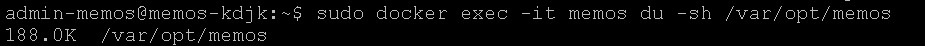

Hasil pengecekan menunjukkan bahwa direktori `/var/opt/memos` memiliki ukuran **188.0K**.

### 2. Mengecek Kapasitas Penyimpanan VPS

Kapasitas penyimpanan VPS dapat dipantau menggunakan perintah:

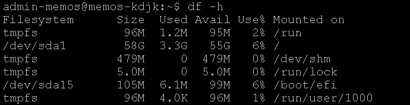

Berdasarkan hasil pengecekan, partisi utama VPS (`/dev/sda1`) memiliki kapasitas **58G**, dengan **3.3G** telah digunakan dan **55G** masih tersedia. Penggunaan storage pada saat pengecekan adalah sebesar **6%**.

### 3. Mengecek File Backup Memos

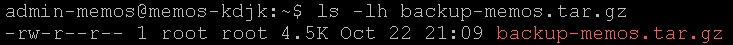
Hasil pengecekan menunjukkan terdapat file `backup-memos.tar.gz` dengan ukuran **4.5K**. File tersebut merupakan file backup yang disediakan sebagai cadangan data Memos.

### 4. Mengecek Penggunaan RAM (Memori) VPS

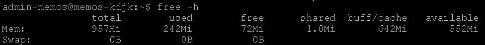

Hasil pengecekan menunjukkan bahwa VPS memiliki total memory sebesar **957MiB**. Pada saat pengecekan, memori yang digunakan sebesar **242MiB**, sedangkan memori yang tersedia sebesar **552MiB**.

### 5. Mengecek Spesifikasi Container Memos

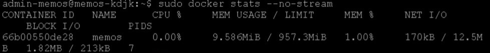

Hasil pengecekan menunjukkan bahwa container Memos menggunakan **0.00% CPU** dan **9.586MiB** memori dari total **957.3MiB** atau sekitar **1.00%** penggunaan memori. Selain itu, penggunaan jaringan dan block I/O pada container juga dapat dilihat melalui hasil `docker stats`.

## Otomatisasi

Untuk mempermudah proses pengerahan (_deployment_) aplikasi Memos tanpa perlu mengeksekusi perintah terminal satu per satu secara manual, telah disediakan skrip otomatisasi (_one-line automated shell script_). Skrip ini dirancang agar pengguna dapat melakukan pengerahan sistem secara instan, praktis, dan _foolproof_.

---

### Instalasi Instan (One-Line Automated Script)

Pengguna cukup menjalankan **satu baris perintah** berikut di dalam terminal VPS untuk menginstal seluruh dependensi sekaligus menjalankan aplikasi Memos:

```bash
curl -sSL https://raw.githubusercontent.com/ravenruze/Projek-Akhir-KDJK/main/setup.sh | bash
```

## Cara Pemakaian

### 1. Membuat Akun

Langkah pertamanya, pengguna harus membuat username dan password terlebih dahulu untuk masuk ke Memos.

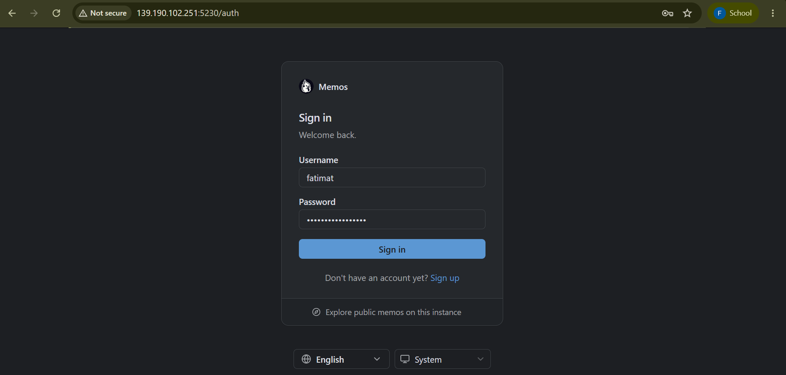

### 2. Halaman Utama

Setelah akun dibuat, pengguna akan diarahkan ke halaman utama Memos. Pada halaman ini terdapat beberapa menu yang dapat digunakan untuk mengakses fitur-fitur Memos.

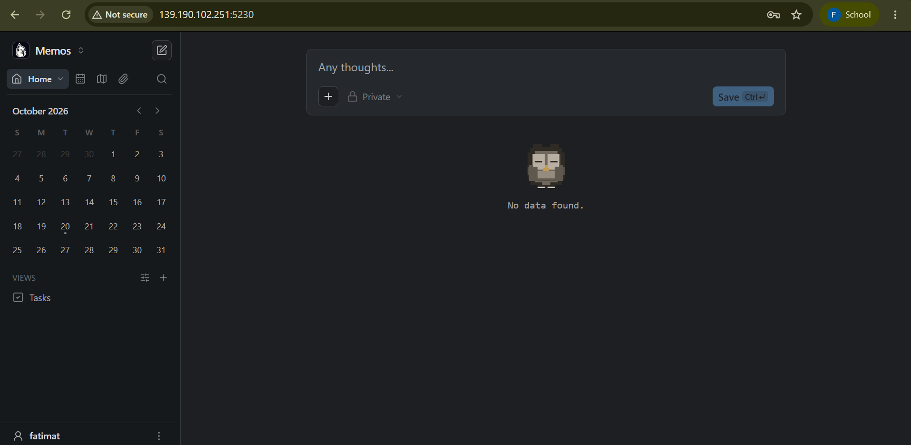

### 3. Membuat Memo

Untuk membuat catatan baru, user dapat memilih menu **New Memo** atau menuliskan catatan melalui **"Any thoughts?"** pada halaman utama.

Pengguna juga bisa mengatur akses catatannya sebagai **public**, **privat**, atau **protected**. Setelah itu pengguna menekan **Save** untuk menyimpan.

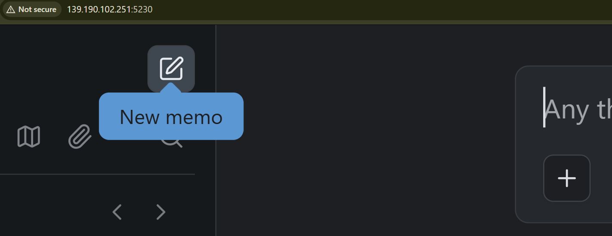

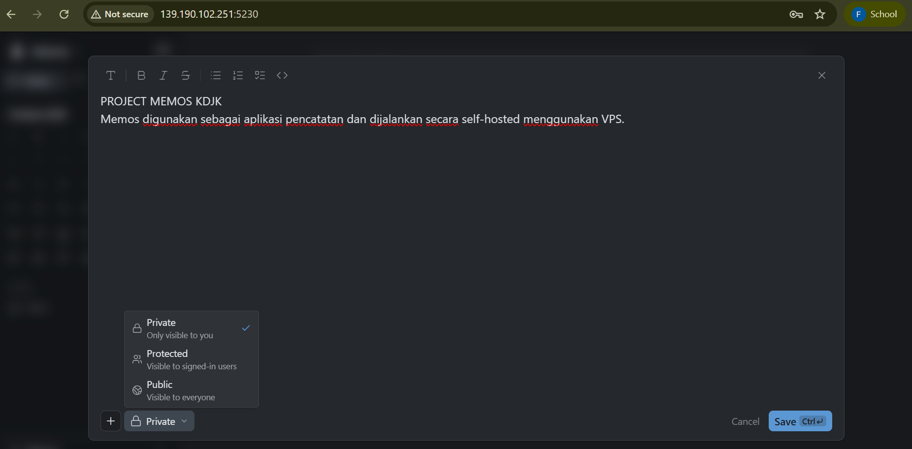

### 4. Membuat Tag

Pengguna juga bisa menambahkan tag (`#`) yang digunakan untuk mengelompokkan catatan berdasarkan topik tertentu, sehingga lebih mudah ditemukan melalui menu **Tag**.

Caranya dengan mengklik titik tiga di samping catatan yang sudah dibuat, lalu pilih **Edit** dan ketik manual `#` sesuai kebutuhan. Tag juga bisa langsung ditambahkan saat penulisan memo di awal.

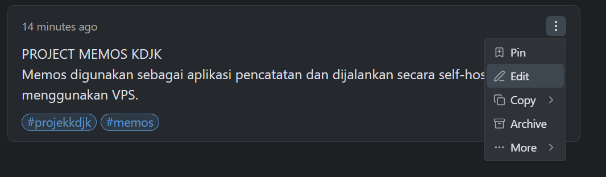

### 5. Searching

Gunakan menu **Search** untuk mencari catatan berdasarkan kata tertentu.

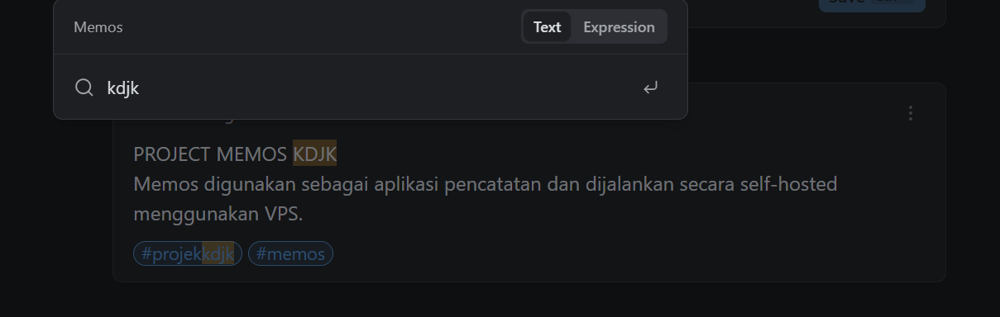

### 6. Melihat Catatan Berdasarkan Waktu

Pengguna dapat memilih menu **Kalender** untuk melihat catatan berdasarkan tanggal pembuatannya. Fitur ini memudahkan pengguna menemukan kembali catatan yang dibuat pada waktu tertentu.

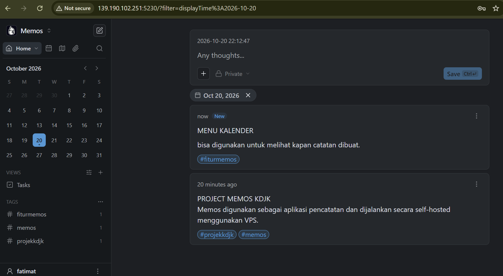

### 7. Menambah Gambar di Catatan / Menambah Attachment

Selain itu, pengguna juga dapat melampirkan foto pada catatan yang mereka buat dengan cara klik titik tiga pada sisi kanan catatan, lalu pilih **Edit** dan **Add Attachment**.

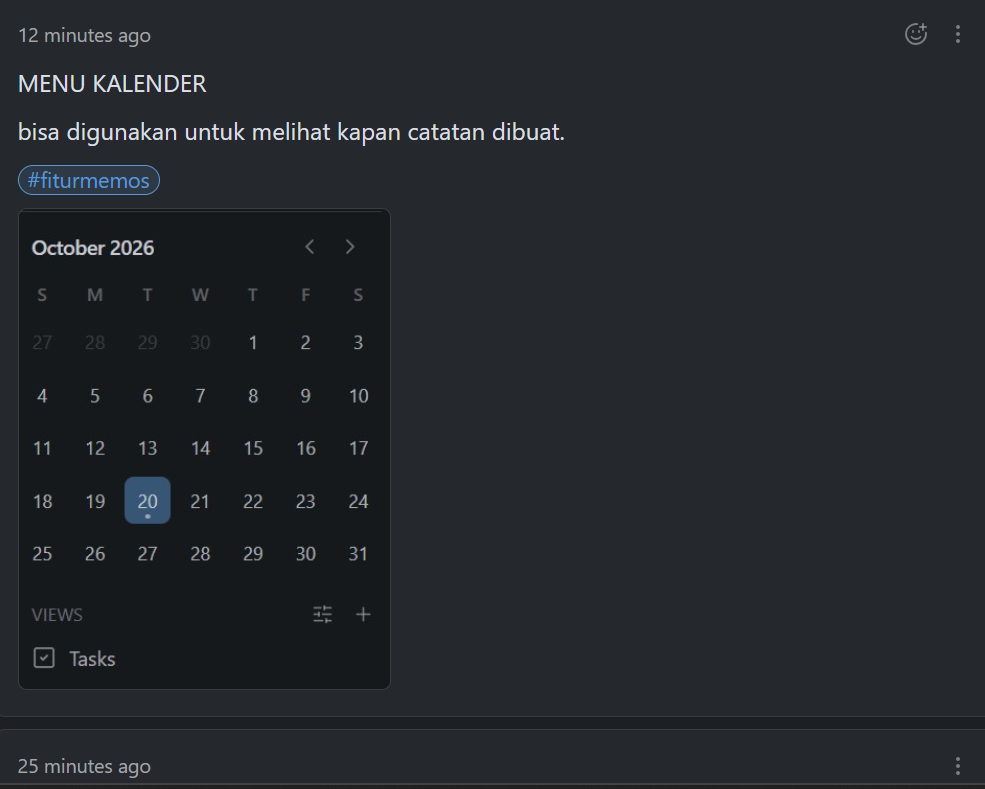

### 8. Melihat Gambar/Dokumen yang Pengguna Upload di Memos

Jika pengguna ingin melihat apa saja yang telah mereka upload di Memos, pengguna dapat melihatnya melalui fitur **Attachment**.

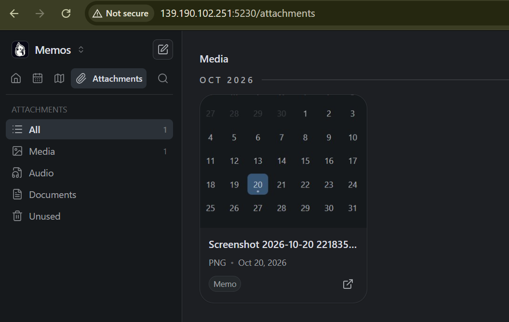

### 9. Menghapus Catatan dan Menyematkan Catatan

Pengguna dapat menghapus catatan yang sudah tidak terpakai dengan cara mengklik titik tiga di samping catatan, lalu pilih **More** dan **Delete**.

Selain itu, jika pengguna ingin catatan yang sifatnya penting tidak tenggelam atau tertimbun oleh catatan lain, maka dapat menggunakan fitur **Pin** untuk menyematkan catatan.

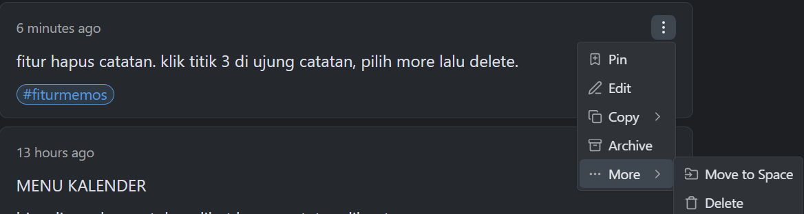

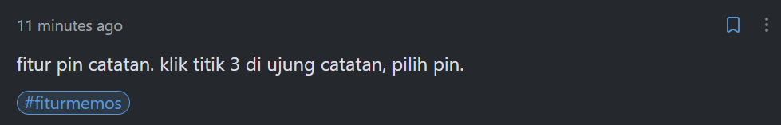

## Pembahasan

### Kelebihan Memos

1. **Kontrol penyimpanan lebih besar.** Memos dapat dijalankan di server sendiri (_self-hosted_) sehingga pengelola memiliki kendali atas lokasi data dan cara server dikelola.
2. **Open-source dan tanpa biaya lisensi aplikasi.** Kode sumber Memos tersedia di bawah lisensi MIT. Meski perangkat lunaknya tidak memerlukan biaya lisensi, biaya VPS, domain, penyimpanan, dan pemeliharaan tetap dapat timbul [7].
3. **Pencatatan cepat dan sederhana.** Memos berfokus pada pencatatan berbentuk timeline, sehingga pengguna dapat menulis tanpa harus terlebih dahulu membuat struktur folder atau halaman yang kompleks [5][7].
4. **Mendukung Markdown.** Format Markdown memudahkan penulisan catatan terstruktur dan membuat isi catatan lebih mudah dipindahkan atau diproses dengan alat lain [6].
5. **Catatan mudah ditelusuri.** Tag, pencarian, kalender/timeline, dan pin membantu pengguna menemukan kembali catatan yang sudah dibuat [5][6].
6. **Dapat dikembangkan dan diintegrasikan.** Memos menyediakan API dan pilihan konfigurasi basis data, sehingga pengelola dapat mengembangkan penggunaan sesuai kebutuhan. SQLite cocok untuk penggunaan satu instance dan skala kecil; kebutuhan yang lebih besar dapat mempertimbangkan MySQL atau PostgreSQL [1][8].

### Kekurangan Memos

1. **Memerlukan kemampuan teknis.** Pengguna atau pengelola perlu memahami Docker dan dasar administrasi server untuk memasang, memperbarui, serta memeriksa aplikasi.
2. **Pemeliharaan menjadi tanggung jawab pengelola.** Keamanan server, pembaruan aplikasi, pencadangan basis data dan berkas lampiran, serta uji pemulihan data harus dikelola secara rutin [4][9].
3. **Ada biaya infrastruktur.** Walaupun aplikasi bersifat open-source, penggunaan VPS, domain, atau layanan pendukung dapat memerlukan biaya.
4. **Tidak berfokus pada manajemen proyek yang kompleks.** Fitur inti Memos berorientasi pada pencatatan dan penelusuran memo. Kebutuhan seperti database relasional yang luas, dashboard proyek, atau alur kerja tim yang kompleks mungkin lebih cocok ditangani aplikasi lain seperti Notion [5][10].
5. **Keamanan akses perlu dikonfigurasi dengan benar.** Jika dibuka ke internet, pengelola perlu memeriksa pengaturan autentikasi dan visibilitas memo serta menerapkan HTTPS. Kesalahan konfigurasi akses dapat membuat catatan atau lampiran yang seharusnya privat terekspos [4][9].
6. **SQLite lebih sesuai untuk deployment sederhana.** SQLite merupakan pilihan bawaan dan praktis untuk satu instance, tetapi deployment yang membutuhkan pengelolaan basis data terpisah atau skala lebih besar dapat memerlukan MySQL/PostgreSQL dan konfigurasi tambahan [8].

### Perbandingan Memos dengan Google Keep dan Notion

Perbandingan berikut berfokus pada kebutuhan penggunaan, penyimpanan, format catatan, dan tanggung jawab pengelolaan. Setiap aplikasi memiliki tujuan yang berbeda, sehingga bukan berarti satu aplikasi selalu lebih baik untuk semua kebutuhan.

| Aspek                          | Memos                                                                              | Google Keep                                                                    | Notion                                                                       |
| ------------------------------ | ---------------------------------------------------------------------------------- | ------------------------------------------------------------------------------ | ---------------------------------------------------------------------------- |
| Model layanan                  | Open-source dan dapat dijalankan sendiri (_self-hosted_)                           | Layanan berbasis cloud                                                         | Layanan berbasis cloud                                                       |
| Penyimpanan dan kendali data   | Data dapat ditempatkan pada server yang dikelola pengguna                          | Infrastruktur dikelola Google                                                  | Infrastruktur dikelola Notion                                                |
| Kebutuhan server               | Perlu menyiapkan dan memelihara server jika _self-hosted_                          | Tidak perlu mengelola server                                                   | Tidak perlu mengelola server                                                 |
| Format dan pengalaman mencatat | Markdown dan timeline catatan                                                      | Catatan cepat, daftar, gambar, label, warna, dan pengingat                     | Dokumen berbasis blok, halaman, dan struktur workspace                       |
| Pengelompokan dan pencarian    | Tag, pencarian, kalender/timeline, pin, dan filter                                 | Label, pin, warna, dan pencarian                                               | Halaman, basis data, berbagai tampilan, dan pencarian                        |
| Kolaborasi                     | Berbagi memo dan pengaturan visibilitas; kemampuan tim bergantung pada konfigurasi | Dapat berbagi catatan dan berkolaborasi pada catatan                           | Kolaborasi real-time, komentar, dokumen, dan basis data bersama              |
| Biaya                          | Perangkat lunak open-source; infrastruktur mungkin berbayar                        | Tersedia sebagai layanan tanpa biaya untuk penggunaan dasar dengan akun Google | Tersedia paket gratis dan paket berbayar; fitur mengikuti paket yang dipilih |
| Paling sesuai untuk            | Catatan sederhana dengan kendali atas server dan data                              | Catatan singkat sehari-hari dengan pengelolaan yang praktis                    | Dokumentasi terstruktur, basis data, dan koordinasi proyek/tim               |

## Referensi

1. **Memos Official Documentation**
   - _Memos Documentation & Architecture Guide_: [https://usememos.com/docs](https://usememos.com/docs)
   - _Memos GitHub Repository_: [https://github.com/usememos/memos](https://github.com/usememos/memos)

2. **Docker & Containerization**
   - _Docker Engine Installation Guide for Ubuntu_: [https://docs.docker.com/engine/install/ubuntu/](https://docs.docker.com/engine/install/ubuntu/)
   - _Docker Run Reference_: [https://docs.docker.com/engine/reference/commandline/run/](https://docs.docker.com/engine/reference/commandline/run/)
   - _Docker Compose Specification_: [https://docs.docker.com/compose/compose-file/](https://docs.docker.com/compose/compose-file/)

3. **Cloud Infrastructure**
   - _Biznet Gio Cloud Documentation (NEO Virtual Compute)_: [https://docs.biznetgio.com/](https://docs.biznetgio.com/)

